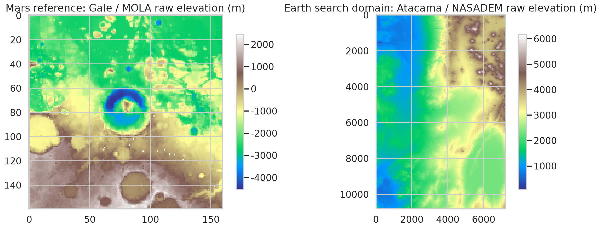
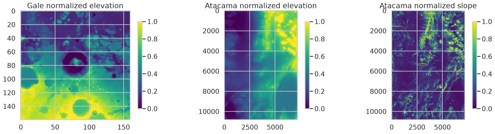
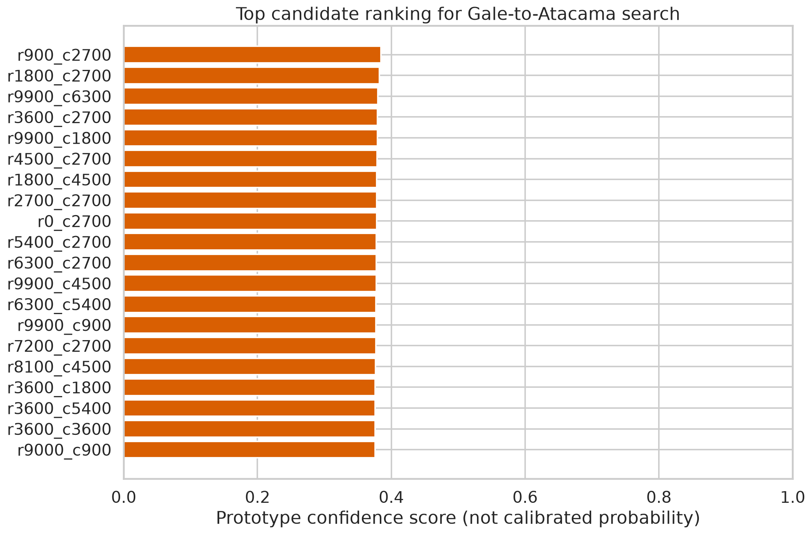

# Prototype results

The reproducible run used the MOLA MEGDR 16 pixels/degree product for a crop around Gale Crater and six NASADEM HGT v001 COG tiles covering the initial Atacama search domain. The run produced **96 candidate cells** after the valid-data filter.

The Gale reference summary was: mean elevation **-1001.95 m**, elevation standard deviation **1472.10 m**, mean slope **2.66 degrees**, and slope standard deviation **2.99 degrees**. These are product-level summaries, not a geological equivalence claim.

The highest prototype confidence score was **0.384**, and the median score was **0.372**. The class counts were:

```text
class
neutral    96
```







## Interpretation

The topography-only run is useful as a screening and software-integration test. It demonstrates that the project can acquire product metadata, read different raster formats, compute metric-aware descriptors, preserve a candidate-level evidence coverage field, and produce an auditable ranking. It does **not** establish that the top cell is a complete planetary analog. Most candidates remain neutral, which is scientifically preferable to overstating confidence when independent spectral, thermal, mineralogical, and ground-truth evidence is absent.

## Reproducible outputs

- `data/algorithm_outputs/candidate_rankings.csv` — candidate table and scores.
- `data/algorithm_outputs/target_summary.json` — reference feature summary.
- `figures/processing/` — raw and harmonized QC figures.
- `figures/algorithm/` — ranking and confidence diagnostics.
- `notebooks/01_end_to_end_colab.ipynb` — Colab workflow.
